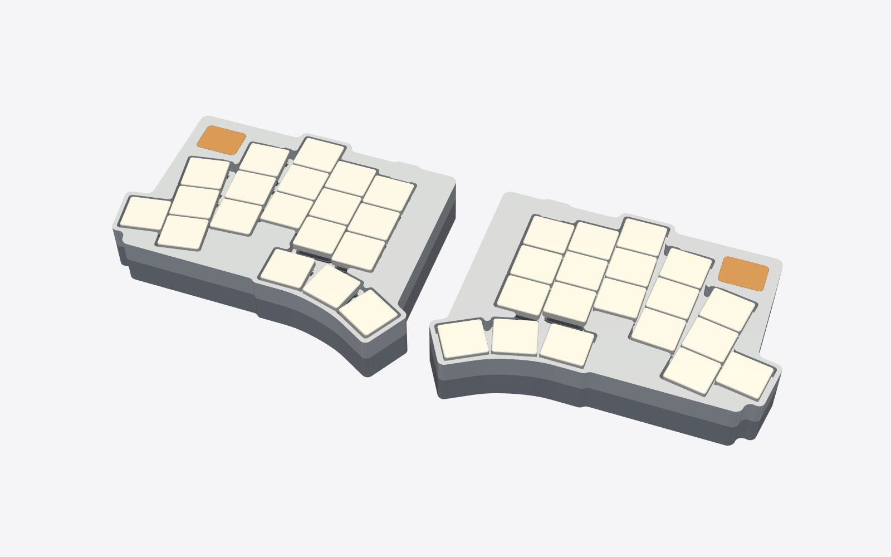
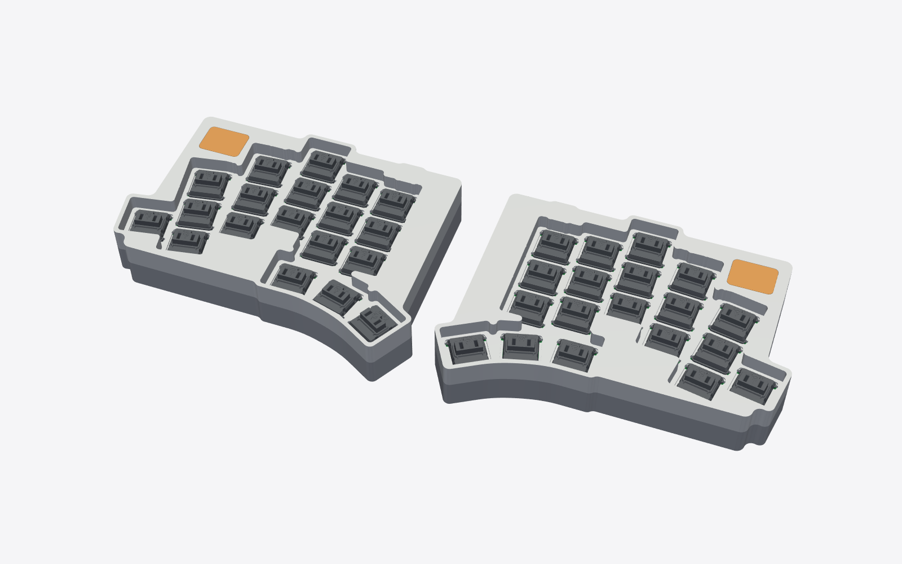
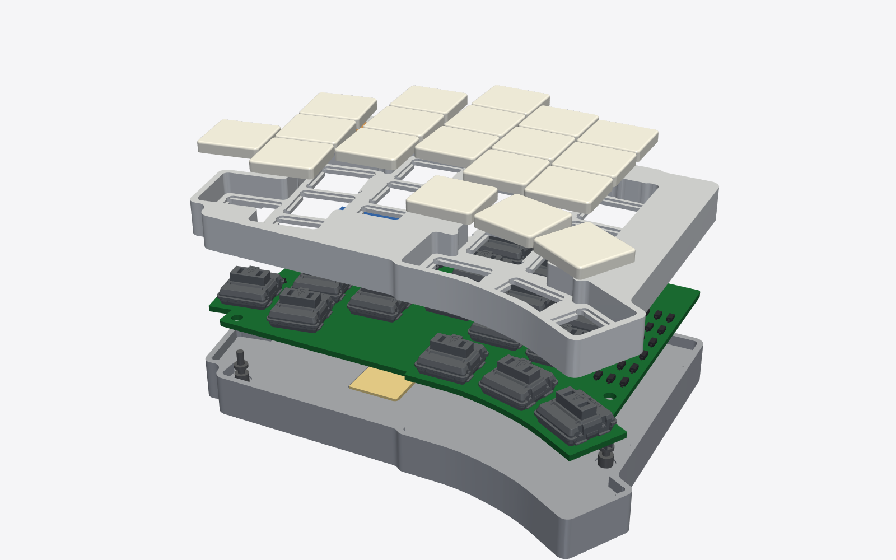
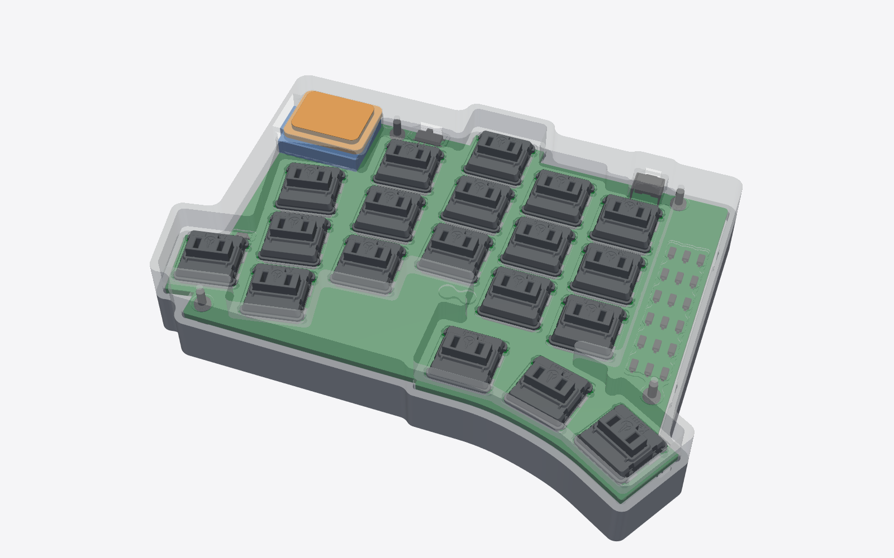
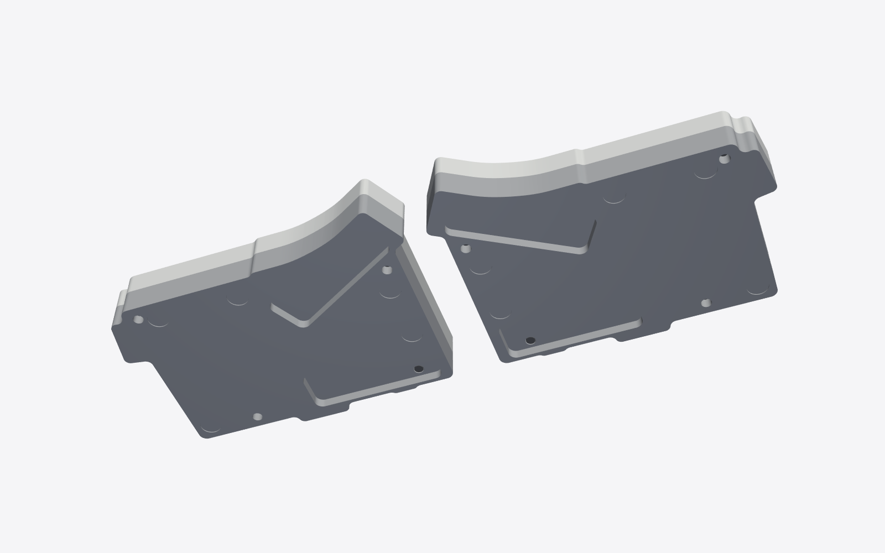
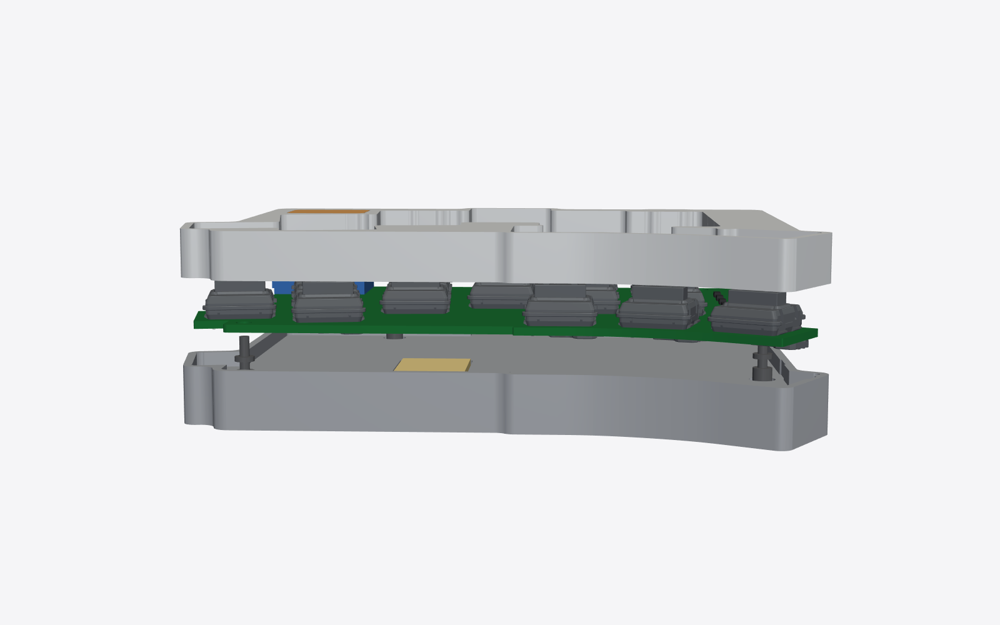

# TOTEM BLE case in aluminum

A case for the [TOTEM](https://github.com/GEIGEIGEIST/TOTEM) split keyboard (BLE build), designed to
be machined from aluminum on a 3-axis mill. It is a new parametric design generated from the TOTEM
KiCad board, not a modified copy of the original case files. Every aluminum surface keeps at least
0.5 mm from the board, its pads and the metal parts on it. A wood window over each XIAO BLE lets the
Bluetooth signal out. The parts fit 140 × 105 mm stock: 1/2" plate for the tops, 7/8" plate for the
bottoms.



| | |
|---|---|
|  |  |
| Without keycaps: flat deck, a well around each key, wood windows over the XIAOs | Exploded: top, PCB with switches and parts, bottom with the battery |
|  |  |
| Left half, top made see-through: the PCB, switches, XIAO and wood window inside | From below: tenting-leg recesses, rubber-feet recesses and the four screw counterbores |
|  | |
| Side view, slightly exploded: top, PCB, bottom with the battery in its pocket | |

The renders come from the STEP files in `outputs/` (`work/render.py`). The keycaps, XIAO and battery
are drawn as plain blocks.

## The design in short

- **Outline:** the board outline grown by 2.3 mm (a 0.5 mm gap plus a 1.8 mm wall), with inside corners
  rounded to R3. It bulges around the reset button, which overhangs the board edge. Each half is
  132.8 × 99.0 mm.
- **Top** (z 0.6 to 10.5, 9.9 mm tall): a flat deck. Each key has a well 1 mm around its keycap
  (floor at 4.25) and a 15.7 mm zone for the switch housing, down to the 1.2 mm clip plate. The plate
  has 13.8 mm cut-outs with corner reliefs for a Ø2 mm end mill. The whole underside is 0.85 mm above
  the board. Blind pockets from below clear the diodes, XIAO, power switch, reset button and solder
  fillets. Openings in the back wall, cut from below, give access to the USB-C port, the power slider
  and the reset plunger. A wood insert closes the window over the XIAO.
- **Bottom** (z −11.4 to 0.6, 12.0 mm tall): one cavity under the whole board, 0.55 mm deeper than
  the lowest socket. It also has a pocket for a 15 × 22 × 7.5 mm LiPo. From below: two recesses for
  the adhesive tenting feet (4.1 mm deep), five Ø9 mm rubber-feet recesses, and four counterbored
  screw holes. The screw holes are the only openings through the part.
- **Assembly:** the board is held by the switches clipped into the top plate and by insulating spacers
  above and below its four no-net mounting pads. The spacers sit in shallow seats and stop 0.1 mm
  from the pads. Four M2 × 12 socket-head screws per half go in from below, through the spacers and
  the mounting holes, into M2 threads tapped in the top. Top and bottom meet on a flat seam at z 0.6.

`outputs/README.md` has the details and the machining notes; `outputs/CHECKS.md` has the measured
clearances, thicknesses and solid checks.

## Files

- `outputs/`: the result
  - `TOTEM_alu_top_L/R.step`, `TOTEM_alu_bottom_L/R.step`, `TOTEM_wood_window_insert_L/R.step`
    (only planes and cylinders)
  - `README.md`: design, hardware and machining notes
  - `CHECKS.md`: measured clearances, thicknesses, machinability and solid checks, with pictures
  - `TOTEM_3d_view.html`: interactive 3D view of the whole build (open it in a browser; it loads
    three.js from unpkg.com)
- `work/`: the scripts
  - `build.py`: the model, with every parameter at the top; regenerates the six STEP files from the board
  - `pcb.py` (reads the KiCad board), `parts.py` (the 3D part models placed from the board file),
    `geom2d.py` (exact 2D regions and offsets on OpenCASCADE)
  - `check.py` and `report.py`: checks and `outputs/CHECKS.md`; `check_all.sh` runs every check and picture
  - `render.py`, `maps.py`, `scene.py`, `export_view.py`: renders, sections, clearance maps, 3D view
  - `orig/`: the original case files, kept for reference only (the build does not read them)
- `docs/images/`: the renders above
- `src/`: the TOTEM PCB (`totem_0_3.kicad_pcb`), its STEP exports (board, parts, pads) and part models

## Rebuilding

Python 3.12 with cadquery 2.8, numpy, shapely, scipy, trimesh, embreex, matplotlib, pillow and vtk
(the setup used here is `~/.venvs/totem-cad`). From `work/`:

```sh
python -E -s build.py              # both halves, about 30 s; or: build.py L / build.py R
PYTHON=python ./check_all.sh       # checks, CHECKS.md, pictures and the 3D view
python -E -s test_variants.py      # editing one footprint changes only its own pocket (a few minutes)
```

The first build reads the 3D part models and caches their boxes in `work/cache/`. The cache is keyed
by the model files and the model entries of the footprints, so moving a footprint does not invalidate
it.

## License

The case is derived from the TOTEM PCB by GEIST (Copyright (c) 2022 GEIST, CERN-OHL-P v2,
`LICENSE.md`): its outline, footprint positions, pads and part models drive the whole model. The case
geometry itself is new, and it is shared under the same licence.
