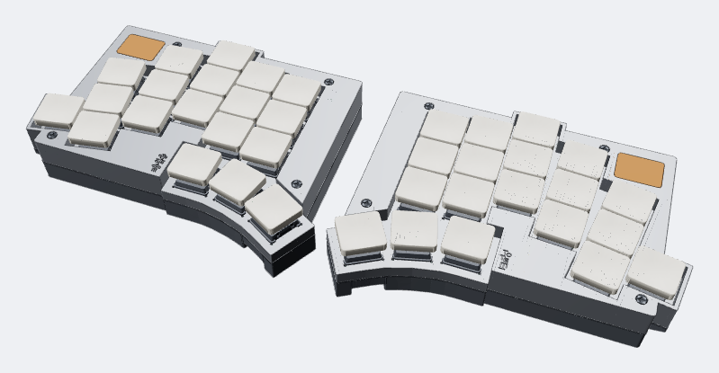
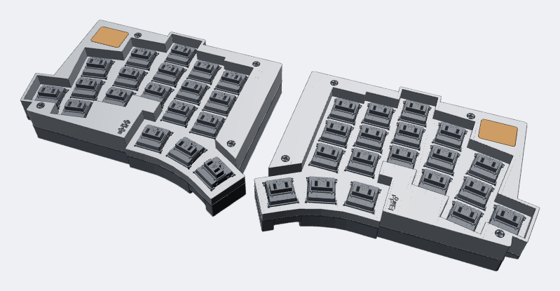
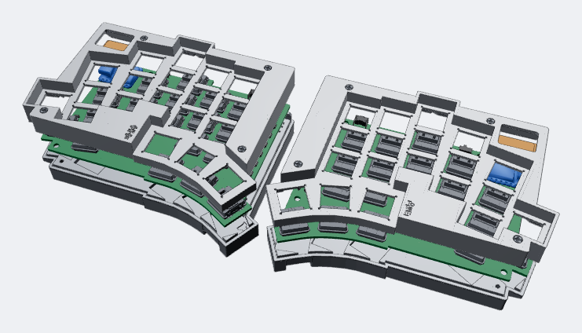
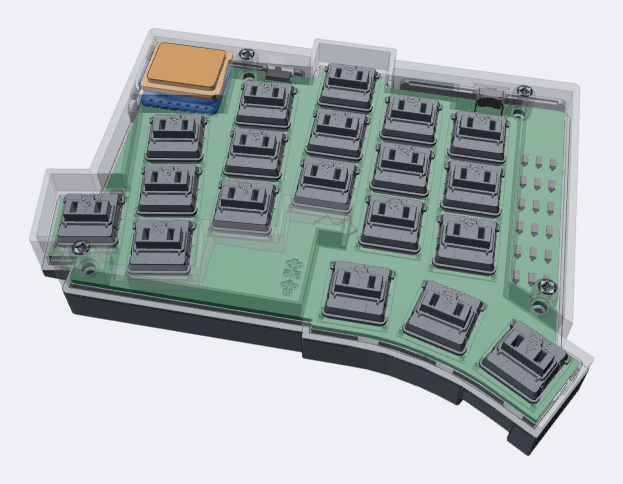
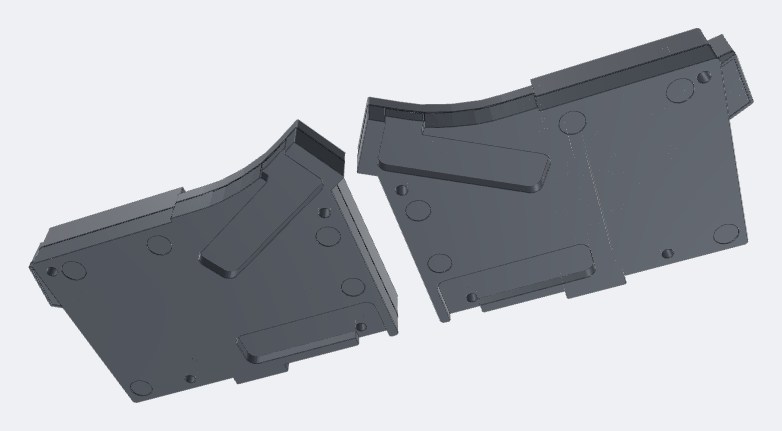
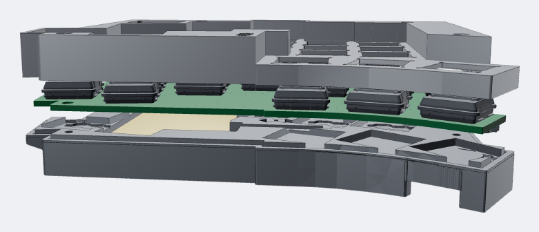

# TOTEM BLE case in aluminum

The [TOTEM](https://github.com/GEIGEIGEIST/TOTEM) split keyboard's BLE case (tenting bottom + top),
reworked so it can be machined from aluminum without shorting the PCB: every aluminum surface keeps
at least 0.5 mm from the board, its pads and the metal parts on it, and a wood window over each
XIAO BLE lets Bluetooth out. The parts fit 105 × 140 mm stock: 1/2" plate for the tops, 7/8" plate
for the bottoms.



| | |
|---|---|
|  |  |
| Without keycaps: the aluminum top and the wood windows over the XIAO | Exploded: top, PCB with switches and parts, bottom |
|  |  |
| Left half, top made see-through: the PCB, switches, XIAO and wood window inside | From below: the tenting-leg recesses, no holes except the screws |
|  | |
| Side view, slightly exploded: top, PCB, and the bottom with the battery in its pocket | |

The renders come from the final STEP files (`work/stills_template.html`, the same scene as the
interactive `outputs/TOTEM_3d_view.html`).

## Files

- `outputs/`: the result
  - `TOTEM_alu_top_L/R.step`, `TOTEM_alu_bottom_L/R.step`, `TOTEM_wood_window_insert_L/R.step`
  - `README.md`: what changed and machining notes
  - `CHECKS.md`: measured clearances, solid checks and pictures
  - `TOTEM_3d_view.html`: interactive 3D view of the whole build (open in a browser; loads three.js
    from unpkg.com)
- `work/`: the scripts that make and check the outputs
  - `build.py L` / `build.py R` regenerates the outputs
  - `check_all.sh` re-runs the checks and rewrites `CHECKS.md`
  - `orig/`: the input case files (copies; never modified)
- `docs/images/`: the renders above
- `src/`: the TOTEM PCB (`totem_0_3.kicad_pcb`), its STEP exports (board, parts, pads) and the part
  models, used to measure clearances

## Rebuilding

Python 3.12 with cadquery, numpy, trimesh, shapely, contourpy, rtree, networkx, manifold3d,
matplotlib and scipy. From `work/`:

```sh
python -E -s build.py L
python -E -s build.py R
PYTHON=python ./check_all.sh
```

## License

Original design: TOTEM, Copyright (c) 2022 GEIST, CERN-OHL-P v2 (`LICENSE.md`). This modified
version is shared under the same licence.
